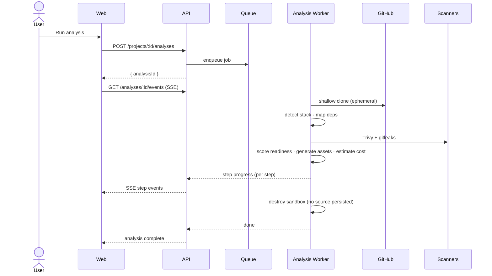
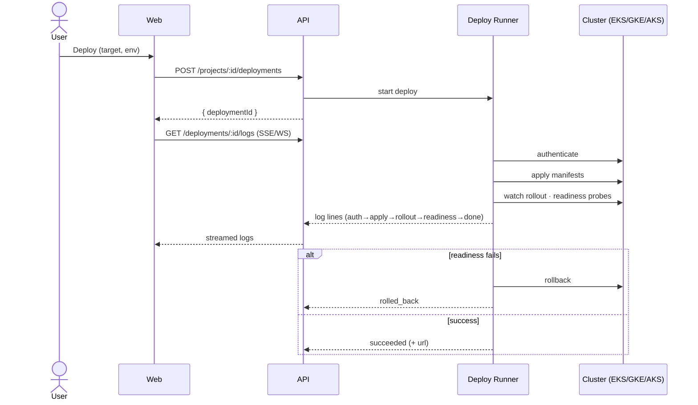

# DevPilot AI — Software Design Document (SDD) & Full Project Plan

> Status: Draft v0.2 · Stage: Prototype → Production planning
> Phase 0 (repository foundation) complete; production architecture direction pending sign-off.
> Source of truth for scope, architecture, and roadmap. Data shapes derive from
> [`handoff/BACKEND_HANDOFF.md`](handoff/BACKEND_HANDOFF.md); design from
> [`design/DESIGN_TOKENS.md`](design/DESIGN_TOKENS.md).

### Document control

| Version | Date | Author | Change |
|---|---|---|---|
| 0.1 | 2026-07-18 | DevPilot team | Initial full SDD (38 sections) |
| 0.2 | 2026-07-18 | DevPilot team | Mark Phase 0 done; add timeline, sprints, assumptions, glossary, decision log, sequence flows |

## Table of contents

1. Executive Summary
2. Business Goals
3. Product Vision
4. Functional Requirements
5. Non-Functional Requirements
6. User Stories
7. Use Cases
8. Information Architecture
9. System Architecture
10. C4 Model
11. Database Design
12. API Design
13. Authentication Flow
14. Authorization
15. Infrastructure Design
16. Networking
17. Cloud Architecture
18. Deployment Architecture
19. Monitoring Strategy
20. Logging Strategy
21. Caching Strategy
22. Security Strategy
23. Disaster Recovery
24. Backup Strategy
25. Testing Strategy
26. Performance Targets
27. Scalability Plan
28. Development Roadmap
29. Coding Standards
30. Repository Standards
31. CI/CD Strategy
32. Sprint Planning
33. Milestones
34. Future Enhancements
35. Risk Assessment
36. Estimated Costs
37. Acceptance Criteria
38. Success Metrics
39. Assumptions, Constraints & Dependencies
40. Stakeholders & RACI
41. Open Decisions (ADR Log)
42. Glossary
- Appendix A — Key Sequence Flows

---

## 1. Executive Summary

DevPilot AI is a SaaS platform that connects to a GitHub repository, analyzes its stack, and
automatically generates production-ready DevOps artifacts — Dockerfile, Docker Compose,
Kubernetes manifests, Helm charts, Terraform, CI/CD pipelines, monitoring configs — alongside
security findings and multi-cloud cost estimates. Users review, edit, and deploy from one
console. The platform compresses days of DevOps setup into minutes and keeps the outputs
current as the repo evolves.

A high-fidelity, fully clickable front-end prototype exists (16 screens, dark + light). This
document defines the production build: architecture, data, APIs, infrastructure, security,
delivery plan, and success criteria.

## 2. Business Goals

- Reduce time-to-first-deploy for a new service from days to minutes.
- Standardize DevOps output quality across teams (secure, cost-aware defaults).
- Monetize via seat-based SaaS (sample plan: **Team @ $49/seat/mo**).
- Land in engineering orgs via GitHub-native onboarding; expand by usage.
- Differentiate on the combination of generation + security + cost + one-click deploy.

## 3. Product Vision

> "Describe your repo once; ship it anywhere, safely, at a known cost."

DevPilot AI is the autopilot layer between source code and running infrastructure. It reads
intent from the codebase, proposes best-practice infrastructure, explains security and cost
tradeoffs, and executes deploys with rollback — while never taking write access it doesn't
need and never persisting user source.

## 4. Functional Requirements

- **FR-1 Connect** a GitHub org/repo via GitHub App (read-only).
- **FR-2 Analyze** a repo at a ref: clone (shallow, ephemeral), detect languages/frameworks,
  map architecture, resolve dependencies, scan secrets & vulnerabilities, score cloud
  readiness, estimate cost. Emit ordered step progress.
- **FR-3 Generate** DevOps assets (Dockerfile, Compose, Kubernetes, Helm, Terraform, CI/CD,
  monitoring). Assets are editable; edits open a PR.
- **FR-4 Security** report: findings with severity, CVE, package, location, remediation, status.
- **FR-5 Cost** estimate per provider (AWS/GCP/Azure) with line items and comparison-to-current.
- **FR-6 Deploy** a bundle to a target (EKS/GKE/AKS) and env (prod/staging), streaming logs;
  support rollback.
- **FR-7 Assistant** — conversational help over analysis context.
- **FR-8 Diagram** — architecture visualization.
- **FR-9 Notifications** — categories (security/deploy/system/mention), unread count, mark-all-read.
- **FR-10 Audit log** — append-only, filterable, CSV export.
- **FR-11 Projects / History** — list repos, past analyses & deployments.
- **FR-12 Integrations & API keys** — connect GitHub/AWS/registry/Slack; create/revoke keys.
- **FR-13 Team & billing** — seats, plan, usage, renewal, payment method.
- **FR-14 Docs** — in-app documentation viewer.

## 5. Non-Functional Requirements

- **Security & privacy** — read-only repo access; ephemeral clone; no source persistence;
  least-privilege scopes; secret redaction in logs.
- **Performance** — see §26.
- **Scalability** — horizontal API + elastic worker pool; see §27.
- **Availability** — 99.9% target for the control plane.
- **Accessibility** — WCAG 2.1 AA; keyboard-navigable; sufficient contrast (tokens already meet it).
- **Responsive** — down to 900px breakpoint and below (mobile off-canvas nav).
- **Observability** — metrics, structured logs, tracing on every request and job.
- **Portability** — cloud-agnostic core; provider adapters isolated.

## 6. User Stories

- As an **owner**, I connect my GitHub org and see all repos' health at a glance.
- As a **developer**, I run an analysis and get a Dockerfile + Kubernetes manifests I can edit.
- As a **security lead**, I see CVEs and secret leaks ranked by severity with remediation.
- As a **platform engineer**, I compare AWS vs GCP monthly cost before committing.
- As an **operator**, I deploy to staging, watch streamed logs, and roll back on failure.
- As an **admin**, I manage seats, API keys, and integrations, and export the audit log.

## 7. Use Cases

- **UC-1 Onboard repo:** install GitHub App → select repo → first analysis auto-runs.
- **UC-2 Generate & PR:** edit generated Terraform → save → PR opened on the repo.
- **UC-3 Streamed deploy:** choose target/env → deploy → live logs (auth→apply→rollout→
  readiness→done) → success URL or rollback.
- **UC-4 Security triage:** open finding → view remediation → mark resolved → audit event logged.
- **UC-5 Cost review:** switch provider/region → recompute → compare to current spend.

## 8. Information Architecture

Client-side routes (from prototype `state.route`):

- **Marketing:** `landing`, `connect`.
- **App shell** (sidebar + topbar + command palette): `dashboard`, `analysis`, `generator`,
  `assistant`, `security`, `cost`, `diagram`, `deploy`, `projects`, `history`,
  `integrations`, `team`, `notifications`, `activity`, `docs`.

Primary flow: Landing → Connect GitHub → Dashboard → Analysis → Generator → Deploy.

## 9. System Architecture

```
              ┌───────────────┐        ┌────────────────────┐
  Browser ──▶ │  Web (SPA)    │ ─────▶ │  API Gateway / BFF │
              └───────────────┘        └─────────┬──────────┘
                                                  │
             ┌────────────────────────────────────┼───────────────────────────┐
             ▼                    ▼                ▼               ▼            ▼
       ┌───────────┐      ┌────────────┐    ┌───────────┐   ┌──────────┐  ┌─────────┐
       │ Auth/     │      │ Projects/  │    │ Analysis  │   │ Deploy   │  │ Billing │
       │ GitHub    │      │ Assets     │    │ Service   │   │ Service  │  │ Service │
       └─────┬─────┘      └─────┬──────┘    └─────┬─────┘   └────┬─────┘  └────┬────┘
             │                  │                 │              │             │
             └──────────────┬───┴─────────────────┴──────────────┴─────────────┘
                            ▼                        ▼
                   ┌────────────────┐        ┌──────────────────┐
                   │ Postgres       │        │ Job queue (Redis │
                   │ (control data) │        │ /NATS) + Workers │
                   └────────────────┘        └──────────────────┘
                                                     │
                        ┌────────────────────────────┼─────────────────────────┐
                        ▼                ▼            ▼             ▼            ▼
                   clone sandbox   Trivy/gitleaks  templating   cost APIs   cluster APIs
                   (ephemeral)     (scanning)      (assets)     (AWS/GCP/…) (EKS/GKE/AKS)
```

- **Web** — SPA rendering the 16 screens.
- **API/BFF** — REST surface (§12), auth, request fan-out, SSE/WebSocket streaming.
- **Services** — auth/GitHub, projects/assets, analysis, deploy, billing.
- **Workers** — analysis pipeline, deploy runner, cost estimator, notification/audit emitters.
- **Data** — Postgres (control plane), Redis (cache + queue), object store (asset bundles/exports).

## 10. C4 Model

- **Context (L1):** Users (owner/admin/member/bot) ↔ DevPilot AI ↔ GitHub, cloud providers
  (AWS/GCP/Azure), scanners (Trivy/gitleaks), Slack/email.
- **Container (L2):** Web SPA, API/BFF, Analysis Service, Deploy Service, Auth Service, Worker
  pool, Postgres, Redis/NATS, Object store.
- **Component (L3, Analysis Service):** Clone manager, Language detector, Dependency resolver,
  Security scanner adapter, Cloud-readiness scorer, Asset generator (templating), Cost
  estimator, Progress emitter.
- **Code (L4):** per-service modules; documented in each service's README as built.

## 11. Database Design

Core entities (see handoff for full fields). Postgres, UUID PKs, `created_at`/`updated_at`,
soft-delete where relevant.

- `users` (id, name, email, avatar_initials, role, team_id)
- `teams` (id, name, plan, seats, usage_this_month, renewal_date, payment_method)
- `plan_features` (team_id, feature)
- `projects` (id, name, org, default_branch, provider, health_score, security_score,
  deploy_readiness, cloud_readiness, last_analyzed_at, status, team_id)
- `analyses` (id, project_id, ref, status, started_at, finished_at, progress_pct)
- `analysis_steps` (id, analysis_id, ordinal, title, detail, meta, meta_severity)
- `detected_stack` (id, analysis_id, name, version)
- `recommendations` (id, analysis_id, severity, title, body)
- `generated_assets` (id, analysis_id, key, name, size_bytes, language, content, status)
- `security_findings` (id, analysis_id, severity, cve, title, package, location, status, remediation)
- `cost_estimates` (id, analysis_id, provider, region, monthly_total, comparison_to_current)
- `cost_line_items` (id, cost_estimate_id, label, monthly)
- `deployments` (id, project_id, asset_bundle_id, target, env, version, status, started_at,
  duration_ms, url)
- `deployment_logs` (id, deployment_id, ts, text, level)
- `notifications` (id, user_id, category, title, body, created_at, read)
- `audit_events` (id, team_id, category, title, actor_id, target, source, status, created_at) — append-only
- `integrations` (id, team_id, kind, name, status, config)
- `api_keys` (id, team_id, name, token_hash, token_preview, scope, last_used_at, created_at)

Indexes: FK columns, `analyses(project_id, status)`, `notifications(user_id, read)`,
`audit_events(team_id, created_at)`. `generated_assets.content` may move to object store if large.

## 12. API Design

REST, JSON, versioned under `/v1`. Long-running work returns a job id and streams progress via
SSE/WebSocket. Full surface in the handoff; summary:

```
Auth/GitHub:  POST /auth/github/connect · GET /me · GET|PATCH /team
Projects:     GET|POST /projects · GET /projects/:id
Analysis:     POST /projects/:id/analyses · GET /analyses/:id
              GET /analyses/:id/events (SSE) · /stack · /recommendations
Assets:       GET /analyses/:id/assets · GET|PUT /assets/:id · GET .../assets/download
Security/Cost:GET /analyses/:id/security · GET /analyses/:id/cost?provider=AWS
Deploy:       POST /projects/:id/deployments · GET /deployments/:id
              GET /deployments/:id/logs (SSE/WS) · GET /projects/:id/deployments
Notif/Audit:  GET /notifications?filter=unread · POST /notifications/read-all
              GET /notifications/unread-count · GET /audit?category · GET /audit/export.csv
Settings:     GET /integrations · POST /integrations/:kind/connect
              GET|POST /api-keys · DELETE /api-keys/:id
```

Conventions: pagination (`?limit&cursor`), idempotency keys on POST that trigger jobs,
consistent error envelope `{ error: { code, message, details } }`, rate limiting per API key.

## 13. Authentication Flow

- **GitHub App install / OAuth** → callback → exchange code → create/link user & team.
- Server sessions (httpOnly, secure, SameSite cookies) for the web app; short-lived access +
  rotating refresh.
- **API keys** for programmatic access (scoped: read / read-write / admin), stored hashed,
  shown once, revocable.
- Service-to-service: signed internal tokens (mTLS or JWT) between API and workers.

## 14. Authorization

- **RBAC** by role: `owner` > `admin` > `member` > `bot`.
- Team-scoped resources; every query filtered by `team_id`.
- API-key scope enforced per endpoint.
- Sensitive actions (billing, key admin, integration connect, deploy to prod) require
  admin/owner and emit audit events.

## 15. Infrastructure Design

- Containerized services on managed Kubernetes.
- Stateless API/workers; state in Postgres (managed, Multi-AZ), Redis (managed), object store.
- **Ephemeral clone sandboxes** — isolated, network-restricted, disposable pods/microVMs; no
  persistent volume for source.
- Secrets via cloud secret manager; never in images or env files.
- IaC for the platform itself (Terraform), mirroring what the product generates.

## 16. Networking

- Public edge: WAF + CDN + TLS termination → API gateway.
- Private subnets for services and data; no public DB.
- Egress control from clone/scan sandboxes (allowlist package registries + GitHub only).
- Internal service mesh (mTLS) for east-west traffic.
- SSE/WebSocket paths for analysis progress and deploy logs.

## 17. Cloud Architecture

- Cloud-agnostic core; provider adapters for cost (price lists) and deploy (EKS/GKE/AKS).
- Reference primary: AWS eu-west-1 (matches sample cost model). Multi-region ready.
- Managed services: Kubernetes, Postgres, Redis, object storage, secret manager, queue.

## 18. Deployment Architecture

- Environments: `dev` → `staging` → `production`.
- Blue/green or rolling for services; migrations gated and reversible.
- **Product deploy runner:** auth to cluster → apply manifests → watch rollout → readiness
  probes → stream logs → success URL; automatic rollback on failed readiness.
- Progressive delivery (canary) as a later enhancement.

## 19. Monitoring Strategy

- Metrics (Prometheus-compatible): request rate/latency/error (RED), queue depth, job
  duration per pipeline step, deploy success rate, scanner runtime.
- Dashboards mirror the product's own dashboard tiles (health/security/deploy/cloud scores).
- Alerting on SLO burn, queue backlog, error spikes, failed deploys.

## 20. Logging Strategy

- Structured JSON logs, correlation/trace id per request and job.
- **Secret redaction** mandatory (this platform handles user source & scan output).
- Central aggregation with retention tiers; audit events stored separately (immutable, exportable).

## 21. Caching Strategy

- Redis for: session/auth, unread-notification counts, cost price-list caches, provider
  metadata, idempotency records.
- HTTP caching/ETags for asset content reads.
- Never cache user source or raw scan artifacts.

## 22. Security Strategy

- Read-only GitHub; PRs never pushed to default branch without approval.
- Ephemeral shallow clone; **source not persisted**; sandbox network egress allowlisted.
- Least-privilege scopes; secret scanning across git history; secrets never stored/logged.
- API keys hashed + previewed + revocable. RBAC + audit on sensitive actions.
- Dependency and container scanning in CI; SAST/secret scanning on the platform's own repo.
- Encryption in transit (TLS) and at rest. Regular key rotation. See `SECURITY.md`.

## 23. Disaster Recovery

- **RPO ≤ 15 min**, **RTO ≤ 1 hour** for the control plane.
- Multi-AZ Postgres with automated failover; cross-region backup copies.
- IaC + documented runbooks enable rebuild of the environment from scratch.
- Because user source is ephemeral, DR scope excludes it by design.

## 24. Backup Strategy

- Postgres: automated daily snapshots + PITR (WAL), 30-day retention, cross-region copy.
- Object store: versioning + lifecycle rules for asset bundles/exports.
- Quarterly restore drills; backups encrypted; access audited.

## 25. Testing Strategy

- **Unit** — services, generators, scorers (TDD; see `superpowers:test-driven-development`).
- **Integration** — API + DB + queue; provider adapters against recorded fixtures.
- **Contract** — API responses must match the shapes the front-end renders (handoff = contract).
- **E2E** — key flows (onboard → analyze → generate → deploy) via browser automation.
- **Security** — scanner regression, authz tests, secret-redaction tests.
- **Performance** — load tests against §26 targets. Coverage gate in CI.

## 26. Performance Targets

- API p95 latency < **300ms** (non-job endpoints).
- Analysis pipeline (typical repo) end-to-end < **90s**; first step progress < **3s**.
- Deploy log first line < **2s** after trigger.
- Dashboard initial render < **1.5s** on broadband; interactions < **100ms**.

## 27. Scalability Plan

- Stateless API behind autoscaler (HPA on CPU + RPS).
- Elastic worker pool scaled by queue depth; per-tenant fairness/quotas.
- Postgres read replicas for read-heavy endpoints; partition high-volume tables
  (`deployment_logs`, `audit_events`) by time.
- Backpressure + idempotency to absorb bursts of analyses/deploys.

## 28. Development Roadmap

- **Phase 0 — Foundations:** repo structure, git strategy, docs, SDD. ✅ **Done.**
- **Phase 1 — Front-end production build:** migrate the 16 prototype screens to the chosen
  framework, preserving design; component library + design tokens.
- **Phase 2 — Backend core:** auth/GitHub, projects, analysis pipeline (detect → scan →
  generate), Postgres/queue.
- **Phase 3 — Security & cost:** findings, remediation, multi-cloud cost estimator.
- **Phase 4 — Deploy:** streamed deploy runner + rollback; history.
- **Phase 5 — Collaboration & ops:** notifications, audit, team/billing, integrations, API keys.
- **Phase 6 — Hardening & GA:** performance, DR/backup drills, observability, docs, launch.

## 29. Coding Standards

- SOLID, Clean Architecture, DRY, KISS, YAGNI, Separation of Concerns.
- Typed everywhere (TypeScript / Go). Lint + format enforced in CI.
- Small, focused modules; no duplicated logic; no dead code.
- Front-end: semantic, accessible, responsive; design tokens over ad-hoc values.
- Comments explain constraints, not narration.

## 30. Repository Standards

- Monorepo under `apps/` and `services/` (as added); shared config at root.
- Conventional Commits; `main`/`develop`/`feature/*`; protected `main`.
- Required: PR template, CODEOWNERS (as added), CI green, one approval.
- Config files: `.gitignore`, `.editorconfig`, `.gitattributes`, `.env.example`.

## 31. CI/CD Strategy

- **CI** (`.github/workflows/`): install → lint → typecheck → unit/integration → build →
  security scan (deps + secrets + container). Block merge on failure.
- **CD:** on merge to `develop` → deploy to staging; on merge to `main` (tagged release) →
  production with approval gate. IaC applied via pipeline. Automated rollback on failed readiness.

## 32. Sprint Planning

- 2-week sprints. Each sprint: goal, committed stories, definition of done (tested, reviewed,
  documented, deployed to staging).
- Backlog grooming weekly; capacity-based commitment; demo + retro each sprint end.

**Definition of Done:** code reviewed & merged to `develop`; unit + integration tests passing;
CI green (lint/types/tests/security); docs updated; deployed to staging; acceptance criteria met.

Initial sprint outline (maps to §28 phases; dates relative to kickoff):

| Sprint | Focus | Key deliverables |
|---|---|---|
| S0 | Foundation (done) | Repo, git strategy, docs, SDD |
| S1 | FE shell | Design tokens + Tailwind config; app shell (sidebar, topbar, command palette) |
| S2 | FE core screens | Dashboard, Analysis, Generator rebuilt from prototype |
| S3 | FE remaining screens + API contract stubs | Security, Cost, Deploy, settings screens; typed API client against handoff shapes |
| S4 | Backend scaffold | Auth/GitHub App, Postgres schema + migrations, projects service |
| S5 | Analysis pipeline | Clone sandbox, detector, dependency resolver, progress SSE |
| S6 | Generation + scanning | Asset templating, Trivy/gitleaks adapters, findings |
| S7 | Cost + deploy | Multi-cloud cost estimator; streamed deploy runner + rollback |
| S8 | Ops + hardening | Notifications, audit, billing, observability, perf, DR drill |

## 33. Milestones

| Milestone | Target | Exit criteria | Status |
|---|---|---|---|
| **M1** — Foundation | Wk 0 | Repo, git strategy, docs, SDD in place | ✅ Done |
| **M2** — FE shell + 3 core screens | Wk 4 | Dashboard/Analysis/Generator match prototype; tokens systemized | Planned |
| **M3** — First real analysis | Wk 10 | Live repo → detect → generate assets end-to-end | Planned |
| **M4** — Security + cost | Wk 14 | Findings + multi-cloud cost live against handoff shapes | Planned |
| **M5** — Streamed deploy | Wk 18 | Deploy to staging with live logs + rollback | Planned |
| **M6** — GA | Wk 24 | Team/billing, hardening, SLOs met, DR drill passed | Planned |

Targets are indicative (single squad, 2-week sprints); re-baseline after S1 velocity is known.

## 34. Future Enhancements

- Canary/progressive delivery; GitOps mode.
- GitLab/Bitbucket providers.
- Policy-as-code guardrails (OPA); custom asset templates.
- Cost anomaly detection; savings recommendations.
- Self-hosted/on-prem edition; SSO/SAML/SCIM.

## 35. Risk Assessment

| Risk | Impact | Likelihood | Mitigation |
|---|---|---|---|
| Handling user source (leak) | High | Med | Ephemeral sandbox, no persistence, egress allowlist, redaction |
| Cloud cost of scan/deploy pool | Med | Med | Autoscale to zero, per-tenant quotas, spot workers |
| Provider API drift (cost/deploy) | Med | Med | Adapter isolation, recorded fixtures, contract tests |
| Design drift from prototype | Med | Med | Tokenized design system, visual review in PRs |
| Scope creep pre-GA | Med | High | Phased roadmap, YAGNI, milestone gates |
| Vendored dc-runtime coupling | Low | Low | Drop runtime at Phase 1 migration |

## 36. Estimated Costs

- **Reference product-workload sample** (AWS eu-west-1, per handoff): ~**$412/mo** — EKS $73,
  3× t4g.medium $180, RDS Multi-AZ db.t4g.medium $124, ALB $22, CloudWatch $13. This is the
  *example tenant estimate the product renders*, not the platform bill.
- **Platform infra (early stage, order-of-magnitude):** managed K8s + Postgres + Redis +
  object store + observability ≈ low-thousands $/mo, scaling with tenants and worker usage.
- Cost controls: scale-to-zero workers, spot for scanners, budget alerts.

## 37. Acceptance Criteria

- All 16 screens exist in production front-end, visually matching the prototype (tokens/motion).
- Analysis pipeline produces the 11 sample asset types with editable content and PR-on-edit.
- Security, cost, and deploy flows return data in the handoff shapes and stream progress.
- Read-only GitHub + ephemeral clone + no-source-persistence verified by tests.
- CI green (lint, types, tests, security). Performance targets (§26) met in staging.
- Docs (README, SDD, API, runbooks) complete and current.

## 38. Success Metrics

- **Activation:** % of connected repos with ≥1 completed analysis (target > 70%).
- **Time-to-first-deploy:** median < 30 min from connect.
- **Generation acceptance:** % of generated assets merged (target > 50%).
- **Security impact:** median time-to-remediate high findings.
- **Reliability:** deploy success rate > 95%; control-plane uptime 99.9%.
- **Business:** paid seats, net revenue retention, weekly active teams.

## 39. Assumptions, Constraints & Dependencies

**Assumptions**
- GitHub is the launch VCS; other providers come later (§34).
- The prototype's data shapes are the API contract (high-fidelity, per handoff).
- One engineering squad delivers the phased roadmap; re-baseline on measured velocity.

**Constraints**
- User source code must never be persisted; clones are ephemeral (hard security constraint).
- GitHub access is read-only; writes happen only as PRs with approval.
- Visual design is fixed to the prototype tokens; no redesign without sign-off.
- `apps/web/support.js` is vendored/generated and dropped at Phase 1, not maintained.

**Dependencies (external)**
- GitHub App / OAuth, Trivy + gitleaks, cloud provider APIs (AWS/GCP/Azure price lists +
  cluster APIs EKS/GKE/AKS), Slack/email for notifications, Google Fonts (Geist, JetBrains Mono).

## 40. Stakeholders & RACI

| Activity | Product | Eng Lead | Frontend | Backend | Security | DevOps |
|---|---|---|---|---|---|---|
| Scope / roadmap | A | R | C | C | C | C |
| Architecture (SDD) | C | A/R | C | R | C | R |
| FE screen build | C | A | R | C | I | I |
| Analysis/gen pipeline | I | A | I | R | C | C |
| Deploy runner | I | A | I | R | C | R |
| Security controls | C | C | I | C | A/R | C |
| CI/CD + infra | I | C | I | C | C | A/R |

R = Responsible · A = Accountable · C = Consulted · I = Informed.

## 41. Open Decisions (ADR Log)

Record each as an ADR under `docs/architecture/adr-NNN-*.md` once resolved.

| # | Decision | Options | Status |
|---|---|---|---|
| ADR-001 | Production front-end architecture | Next.js + TS (recommended) · static multi-page HTML/CSS/JS · keep dc prototype as reference | **Open** |
| ADR-002 | Backend language/runtime | Node/TypeScript · Go | Open |
| ADR-003 | Job queue | Redis (BullMQ) · NATS · cloud-native (SQS/PubSub) | Open |
| ADR-004 | Asset templating engine | Language-native templates · dedicated template DSL | Open |
| ADR-005 | Streaming transport for progress/logs | SSE · WebSocket · both | Open |
| ADR-006 | Clone-sandbox isolation | Restricted K8s pods · microVMs (Firecracker) | Open |
| ADR-007 | License model | Proprietary · open-source (which OSI license) | Open |

## 42. Glossary

- **Analysis** — one pipeline run against a repo at a ref (clone → detect → scan → score → generate → cost).
- **Asset / GeneratedAsset** — a produced DevOps file (Dockerfile, Compose, K8s, Helm, Terraform, CI/CD).
- **dc / dc-runtime** — the Claude Design component framework; `apps/web/support.js` is its generated runtime.
- **Deploy runner** — worker that applies a bundle to a cluster and streams logs.
- **Ephemeral sandbox** — disposable, network-restricted environment for cloning/scanning; leaves no source behind.
- **Finding** — a security issue (CVE or leaked secret) with severity, location, remediation.
- **RED metrics** — Rate, Errors, Duration.
- **RPO / RTO** — Recovery Point / Time Objective.
- **SSE** — Server-Sent Events (one-way streaming).

---

## Appendix A — Key Sequence Flows

**Analysis pipeline**



**Streamed deploy**



---

*Living document. Update alongside code; record decisions as ADRs under `docs/architecture/`.*
